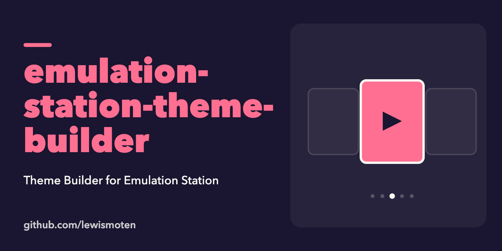

# Emulation Station Theme Builder

An unfinished 2016 experiment toward a browser tool for building themes for [EmulationStation](https://emulationstation.org/). The page has draggable boxes and drop zones (using interact.js and jQuery), and `theme/theme.xml` holds a sample theme file.

## Status

Early prototype, not maintained.

## Run

```sh
npm install
npx gulp browser-sync
```

The `browser-sync` task in `gulpfile.js` serves the folder in your browser.
